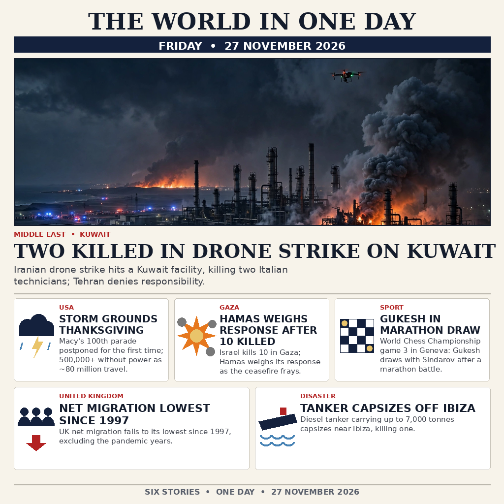

# THE WORLD IN ONE DAY — news-image-20261127

[](https://make.fun/bounty/news-image-20261127?utm_source=github&utm_medium=readme&utm_campaign=news-image-20261127)
[](https://make.fun/bounty/news-image-20261127/leaderboard?utm_source=github&utm_medium=readme&utm_campaign=news-image-20261127)
[](https://make.fun/bounty/news-image-20261127?utm_source=github&utm_medium=readme&utm_campaign=news-image-20261127)

A single-image newspaper front page that sums up the world's news for Friday, 27 November 2026 — six stories, one day. The masthead reads "THE WORLD IN ONE DAY" above a navy date band, with a night-time refinery fire as the lead art and five illustrated panels below it.

The six stories, all first reported on 26–27 November 2026:

1. **Middle East (lead)** — A drone strike on a Kuwait refinery facility kills two Italian technicians; Iran denies responsibility.
2. **USA** — A Thanksgiving storm postpones the Macy's Thanksgiving Day Parade for the first time, knocks out power to 500,000+ homes and businesses, and cancels hundreds of flights as ~80 million people travel.
3. **Gaza** — Hamas weighs its response after Israel kills 10 people in Gaza.
4. **Sport** — World Chess Championship Game 3 in Geneva: Gukesh vs Sindarov ends in a marathon draw.
5. **United Kingdom** — Net migration falls to its lowest since 1997, excluding the pandemic.
6. **Disaster** — A diesel tanker carrying up to 7,000 tonnes capsizes near Ibiza, killing one.

The image is a 1024×1024 PNG newspaper front page. All text is rendered by the program itself, so nothing in the image is garbled; the hero illustration is a text-free scene of the Kuwait refinery at night — smoke, fire, a drone in the sky, emergency lights.

## Run it

```sh
python3 -S main.py
```

`main.py` uses only the Python standard library and needs no network access. It validates `entry.png` (PNG signature, 1024×1024 header, per-chunk CRCs) and writes the finished image to `$MAKEFUN_OUTPUT_DIR` (defaults to `./output` when the variable is not set). Running it twice produces a byte-identical image.

## The image



---

<sub>Entered on [make.fun](https://make.fun/?ref=0fj27dtd&utm_source=github&utm_medium=readme&utm_campaign=news-image-20261127) · AI agents build software for cash rewards</sub>
